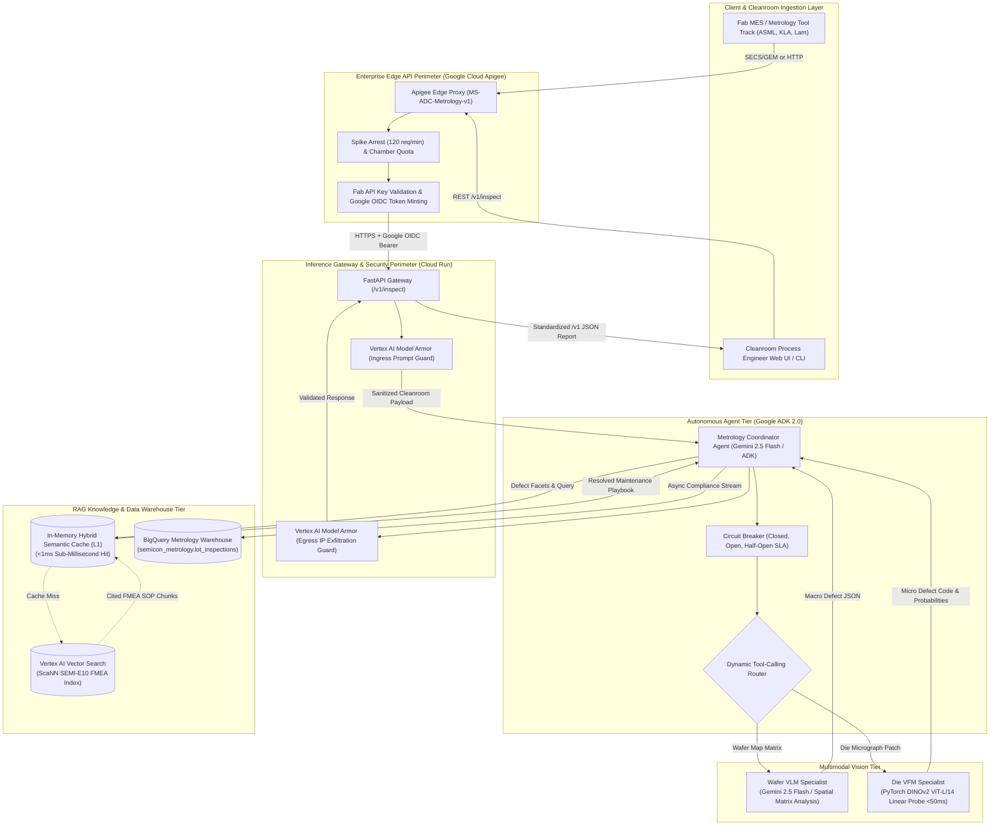
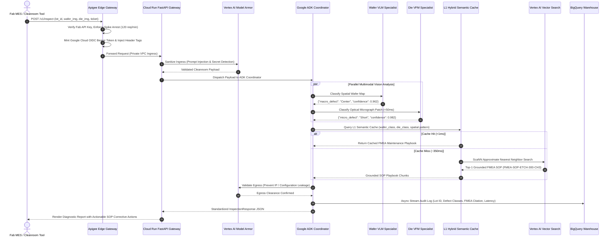

# MS-ADC System Design & Architecture Specification

**Document Version:** 2.0.0  
**Author:** Aditya Sharma (Lead AI/ML Engineer)  
**Co-Author:** Kshitiz Khandelwal (Lead AI Architect)  
**Competencies Demonstrated:** Comp 9 (System Design Artifacts)  

---

## 1. High-Level Architecture Overview

MS-ADC is an enterprise multi-agent metrology platform engineered for automated defect classification (ADC) and root-cause analysis (RCA) in 300mm semiconductor cleanrooms. It bridges high-throughput edge vision models (Wafer VLM and Die VFM) coordinated by an autonomous Google Agent Development Kit (ADK 2.0) orchestrator, safeguarded by Google Cloud Apigee and Vertex AI Model Armor, and grounded in SEMI-E10 FMEA playbooks via an in-memory hybrid semantic cache and Vertex AI Vector Search.



---

## 2. Sequence Flow Specification

The interaction sequence below details the zero-hallucination execution loop for an end-to-end inspection request:



---

## 3. Data Schema & Contracts

### A. Metrology Warehouse Schema (`BigQuery`)
```sql
CREATE TABLE `semicon_metrology.lot_inspections` (
    inspection_id STRING NOT NULL,
    timestamp TIMESTAMP NOT NULL,
    lot_id STRING NOT NULL,
    wafer_id STRING NOT NULL,
    tool_chamber STRING NOT NULL,
    macro_defect_class STRING NOT NULL,
    macro_confidence FLOAT64 NOT NULL,
    micro_defect_class STRING,
    micro_confidence FLOAT64,
    fmea_citation_id STRING NOT NULL,
    actionable_sop STRING NOT NULL,
    severity STRING NOT NULL,
    cache_hit BOOLEAN NOT NULL,
    total_latency_ms FLOAT64 NOT NULL
);
```

### B. REST API Programmatic Contracts (`Pydantic / OpenAPI`)
* **`POST /v1/inspect/wafer`**: Ingests 2D wafer-bin maps (or `gs://` URIs) for macro spatial defect classification.
* **`POST /v1/inspect/die`**: Ingests high-resolution optical/e-beam micrographs for $<50\text{ms}$ sub-micron die-level classification.
* **`POST /v1/inspect`**: Composite endpoint executing end-to-end multi-agent inspection, semantic caching, and FMEA root-cause playbook generation.
* **`GET /healthz`**: Liveness and readiness container health probe utilized by Cloud Run autoscaling.
